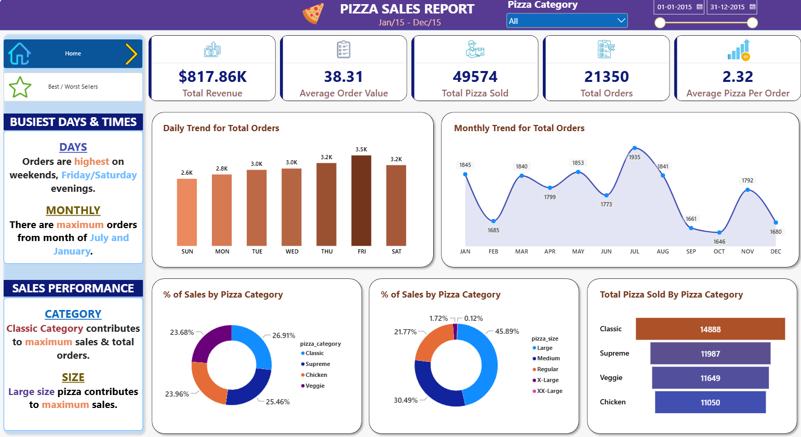
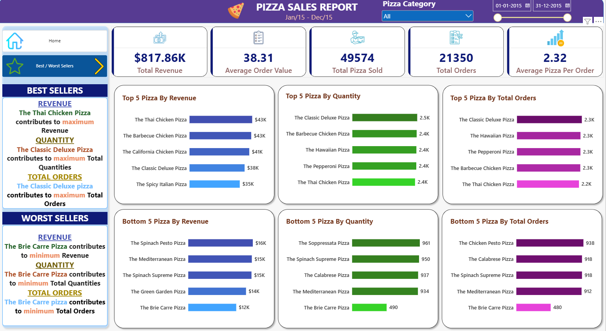

# 🍕 Pizza Sales Analysis | SQL Server & Power BI

## Project Overview

This project analyzes pizza sales data using SQL Server and Power BI to understand sales performance, product popularity, and order trends.

The objective is to help restaurant management answer important business questions, identify sales opportunities, and make data-driven decisions about menu performance and operational planning.

## Business Problem

A pizza restaurant wants to understand its sales performance and identify which products and categories contribute most to revenue.

Management needs insights into:

- Overall revenue and order performance
- Best- and worst-selling pizzas
- Sales contribution by pizza category and size
- Daily and monthly order trends
- Product performance to support menu and promotional decisions

## Tools & Technologies

- **SQL Server:** Data analysis, aggregation, and business queries
- **Power BI Desktop:** Dashboard development and visualization
- **CSV:** Source dataset

## Dataset

The dataset contains 48,620 records and 12 columns, including:

- Order ID
- Pizza name, category, and size
- Quantity sold
- Unit price and total price
- Order date and order time
- Pizza ingredients

Each row represents a pizza line item. An order may contain multiple line items.

The analysis covers sales from January 2015 through December 2015.

## Business Questions

1. What are the restaurant's total revenue, order count, and pizza sales?
2. What is the average revenue per order?
3. Which days of the week have the highest order volume?
4. How do orders change from month to month?
5. Which pizza categories and sizes contribute most to revenue?
6. Which pizzas are the top and bottom performers by revenue, quantity, and number of orders?

## Key Performance Indicators (KPIs)

| KPI | Result |
|---|---:|
| Total Revenue | $817,860.05 |
| Average Order Value | $38.31 |
| Total Pizzas Sold | 49,574 |
| Total Orders | 21,350 |
| Average Pizzas Per Order | 2.32 |

*Currency formatting follows the values displayed in the dataset and report.*

## SQL Analysis

SQL Server was used to calculate business KPIs and analyze sales performance.

The SQL queries include:

- Total revenue, average order value, total pizzas sold, and distinct order count
- Daily and monthly order trends
- Revenue percentage by pizza category and size
- Pizza quantity sold by category
- Top 5 and bottom 5 pizzas by revenue
- Top 5 and bottom 5 pizzas by quantity sold
- Top 5 and bottom 5 pizzas by number of orders

**SQL script:** [View pizza sales queries](sql/pizza_sales_queries.sql)

## Power BI Dashboard

The Power BI report contains two pages: Sales Overview and Best / Worst Sellers.

### 1. Home — Sales Overview

This page presents the main KPIs, daily and monthly order trends, sales contribution by pizza category and size, and quantity sold by category.

### 2. Best and Worst Sellers

This page compares the top and bottom five pizzas by revenue, quantity sold, and number of orders.

**Download the Power BI report:** [pizza_sales_dashboard.pbix](powerbi/pizza_sales_dashboard.pbix)

Open the downloaded file using Power BI Desktop.

## Key Findings

- **Classic pizza category:** Contributed approximately 26.91% of total revenue, the highest share among categories.
- **Large pizza size:** Contributed approximately 45.89% of revenue, the largest share among sizes.
- **Top pizza by revenue:** The Thai Chicken Pizza generated approximately $43.4K in revenue.
- **Top pizza by quantity:** The Classic Deluxe Pizza sold approximately 2,453 units.
- **Busiest weekday:** Friday had the highest order volume in the weekday trend, at approximately 3.5K orders.

These findings describe the sales patterns observed in the dataset.

## Business Recommendations

Based on the observed sales patterns:

- Review the performance of lower-revenue products to identify potential menu or promotional opportunities.
- Prioritize availability of popular pizza varieties, especially during high-demand periods.
- Use weekday and monthly order trends to support staffing and preparation planning.
- Investigate product-level revenue and quantity differences before making menu changes.
